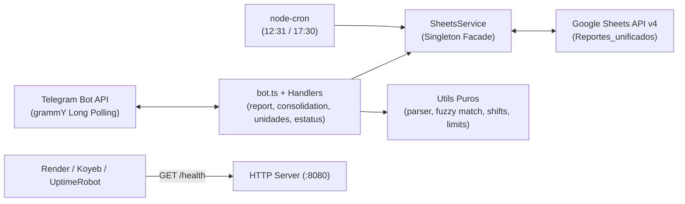

# Telegram Google Sheets Report Bot (`bot-gerencia`)


Bot modular de producción escrito en **TypeScript** con **grammY** y **Google Sheets API v4** que automatiza la ingesta, validación, almacenamiento matricial y consolidación programada de reportes diarios institucionales desde Telegram.

---

## Características Principales

- **Almacenamiento en Matriz Bidimensional (`Reportes_unificados`):** Registra actividades en la intersección exacta de *Unidad (fila)* × *Fecha/Turno (columna)* con soporte de sobrescritura para correcciones (`Guardado ✅` / `Corregido 🔄`).
- **Expansión Dinámica de Cuadrícula:** Crea automáticamente bloques de 2 columnas por día (`12:00M` y `5:30PM`), combina encabezados de fecha y redimensiona `gridProperties.columnCount` en Google Sheets sin intervención manual.
- **Validación Atómica y Coincidencia Difusa:** Procesa reportes de una o múltiples unidades en un mismo mensaje; si una unidad es inválida o excede su cuota de caracteres, rechaza el lote completo con feedback guiado.
- **Presupuesto de Caracteres para Telegram:** Cuotas configurables por unidad (`src/utils/limits.ts`) y particionamiento seguro (`splitMessage`) para garantizar consolidados íntegros dentro del límite de 4.096 caracteres.
- **Consolidación Automática (`node-cron`):** Envía reportes consolidados a gerencia al cierre de cada turno (`12:31` y `17:30`, `America/Caracas`) con reintentos y fallback a texto plano.
- **Modo Silencioso y RBAC Opcional:** Ignora conversaciones normales en grupos y permite restringir el acceso mediante lista blanca (`ALLOWED_CHAT_IDS`).
- **Listo para Producción:** Contenedor Docker multi-etapa con usuario no-root (`node`), servidor HTTP de salud (`/`, `/health`) y apagado controlado (`SIGINT`/`SIGTERM`).

---

## Arquitectura



---

## Comandos del Bot

| Comando | Alias | Descripción |
| :--- | :--- | :--- |
| `/start` | — | Muestra bienvenida e instrucciones de formato. |
| `/reporte [turno] [fecha]` | `/reportes` | Genera el consolidado del turno activo, turno específico (`1`/`2`) o fecha histórica (`DD/MM/YYYY`). |
| `/estatus` | — | Lista unidades que ya reportaron y pendientes del turno activo. |
| `/unidades` | — | Muestra las unidades autorizadas y sus límites de caracteres. |
| `/id` | `/myid` | Devuelve el `chat.id` de Telegram del usuario o grupo. |

---

## Inicio Rápido

### 1. Variables de Entorno
```bash
cp .env.example .env
```
Configura `TELEGRAM_BOT_TOKEN`, `GOOGLE_SHEET_ID`, `GOOGLE_SERVICE_ACCOUNT_EMAIL`, `GOOGLE_PRIVATE_KEY` y opcionalmente `MANAGER_CHAT_ID`, `ALLOWED_CHAT_IDS` y `REPORT_HEADER_TITLE`.

### 2. Desarrollo Local
```bash
npm install
npm run lint
npm run typecheck
npm run test-parse
npm run dev
```

### 3. Despliegue con Docker
```bash
docker compose up -d --build
docker compose logs -f
```

---

## Documentación Técnica

- [PRD (Requisitos del Producto)](./docs/PRD.md)
- [Arquitectura y ADRs](./docs/ARCHITECTURE.md)
- [Modelo de Datos (Google Sheets)](./docs/database_model.md)
- [API y Comandos](./docs/API.md)
- [Design System Conversacional](./docs/DESIGN_SYSTEM.md)
- [Guía de Estilo de Código](./docs/CODE_STYLE.md)
- [Política de Seguridad](./SECURITY.md)
- [Lógica de Negocio](./LOGICA_NEGOCIO.md) · [Manual de Usuario](./MANUAL_USUARIO.md)

---

## Licencia

Distribuido bajo la licencia [MIT](./LICENSE).
