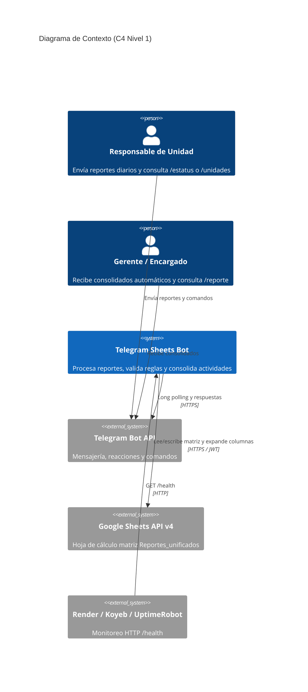
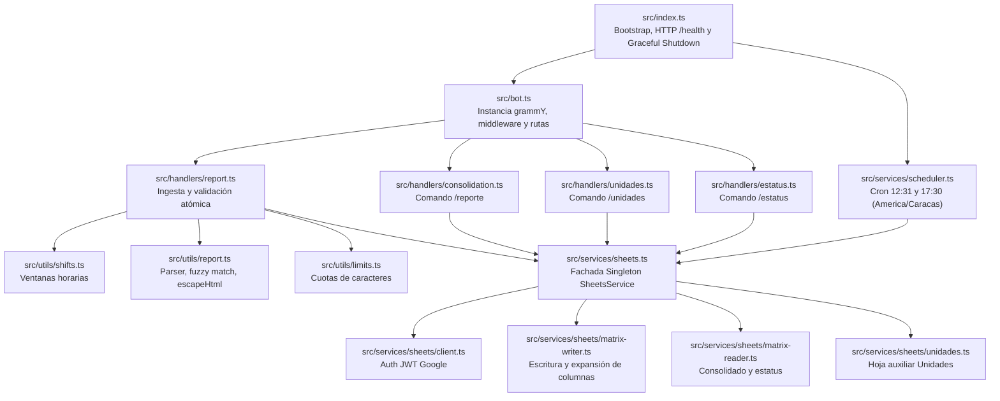
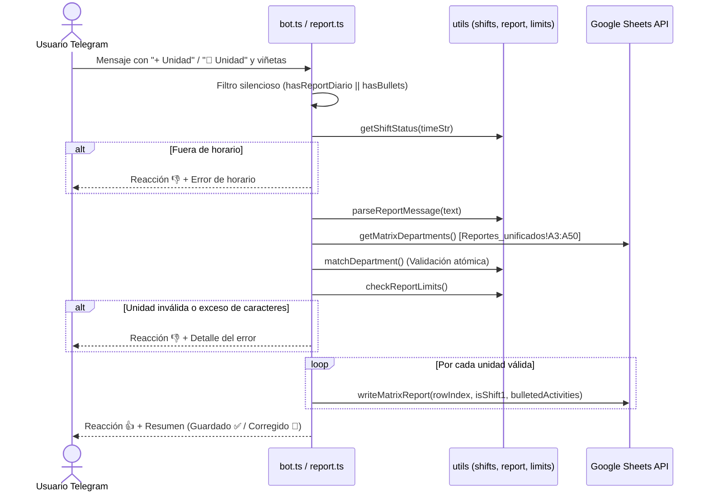

# Arquitectura del Sistema — `telegram-sheets-bot`

## 1. Visión General (C4 — Contexto)

El sistema es un servicio monolítico modular en **Node.js (>=20) + TypeScript** que integra la API de **Telegram** (vía *long polling* con `grammY`) y **Google Sheets API v4** (`googleapis`), acompañado de un planificador `node-cron` y un servidor HTTP ligero para *health checks*.

---

## 2. Contenedores y Módulos Internos (C4 — Componentes)

---

## 3. Flujos Clave

### 3.1 Ingesta de Reporte Diario (`reportHandler`)

### 3.2 Consolidación Automática (`scheduler.ts`)

- **12:31 PM (`31 12 * * *`):** Consolida Turno 1 (`12:00M`) y envía a `config.managerChatIds`.
- **05:30 PM (`30 17 * * *`):** Consolida Turno 2 (`5:30 PM`) y envía a `config.managerChatIds`.
- Incluye lógica de reintentos (`3` intentos, `3000ms` de espera) y degradación a texto plano ante errores de parseo HTML.

---

## 4. Topología de Despliegue

- **Contenedor:** `Dockerfile` multi-etapa basado en `node:20-alpine`.
  - Etapa `builder`: `npm ci` + `npm run build` (`tsc`).
  - Etapa `runner`: `npm ci --only=production`, copia `dist/`, ejecuta bajo `USER node` (`CMD ["node", "dist/index.js"]`).
- **Orquestación local/servidor:** `docker-compose.yml` (`container_name: telegram_sheets_bot`, `restart: unless-stopped`, montaje read-only de `/etc/localtime` y `/etc/timezone`).
- **Plataformas PaaS:** Compatible con Render / Koyeb mediante `PORT` (default `8080`) y endpoints `/` y `/health`.

---

## 5. Registro de Decisiones de Arquitectura (ADRs)

| ADR | Decisión | Justificación |
| :--- | :--- | :--- |
| **ADR-01** | Usar **Google Sheets** en formato matriz (`Reportes_unificados`) como almacenamiento único | Permite a la gerencia inspeccionar y editar el histórico directamente sin infraestructura de BD adicional. |
| **ADR-02** | Usar **Long Polling** de `grammY` + servidor HTTP mínimo de healthcheck | Simplifica el despliegue detrás de NAT/firewalls o PaaS gratuitos sin requerir certificados ni configuración de webhooks. |
| **ADR-03** | **Validación atómica** en reportes multi-unidad | Evita estados parciales en la matriz cuando un coordinador comete un error tipográfico en una de las unidades. |
| **ADR-04** | **Expansión dinámica de cuadrícula** en `matrix-writer.ts` | Evita fallos de la API de Google Sheets al superar las columnas iniciales (por defecto 26 o 51) conforme avanzan los días. |
| **ADR-05** | **Cuotas de caracteres por unidad** en `src/utils/limits.ts` | Garantiza que el consolidado institucional quepa en un solo mensaje de Telegram (≤ 4.096 caracteres). |

