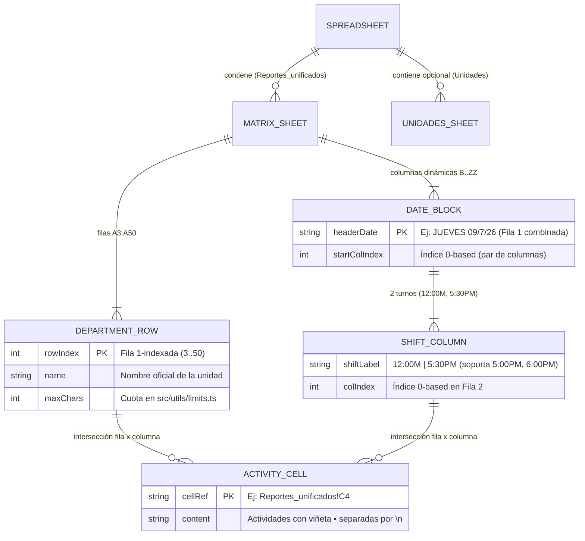

# Modelo de Datos — Google Sheets (`Reportes_unificados` y `Unidades`)

> Este proyecto no utiliza una base de datos SQL/NoSQL tradicional. Toda la persistencia reside en un libro de **Google Sheets** identificado por `GOOGLE_SHEET_ID`, accedido mediante **Google Sheets API v4** (`src/services/sheets/`).

---

## 1. Diagrama Entidad-Relación Lógico (ERD)

---

## 2. Esquema Real de la Pestaña `Reportes_unificados`

Constante definida en `src/services/sheets/utils.ts`: `MATRIX_SHEET_NAME = 'Reportes_unificados'`.

| Rango | Contenido | Formato / Regla |
| :--- | :--- | :--- |
| `A1:A2` | Reservado / Encabezado de columna de unidades | No modificado por el bot |
| `B1:ZZ1` | Fechas combinadas de 2 en 2 columnas (`mergeCells`) | `DIA DD/M/YY` sin cero a la izquierda en el mes (ej. `JUEVES 09/7/26`) |
| `B2:ZZ2` | Etiquetas de turno por columna | Turno 1: `12:00M` · Turno 2: `5:30PM` (lectura compatible con `5:00PM` y `6:00PM`) |
| `A3:A50` | Catálogo oficial de unidades y secciones especiales | Leído dinámicamente por `getMatrixDepartments()` |
| `B3:ZZ50` | Celdas de intersección (actividades del turno) | Sobrescritura idempotente por `writeMatrixReport()`; cada línea con prefijo `▪️ ` |

### Filas Oficiales por Defecto (`A3:A8`)

| Fila | Unidad / Sección | Tipo | Límite de Caracteres |
| :---: | :--- | :--- | :---: |
| 3 | `GERENCIA` | Unidad estándar | 300 |
| 4 | `ENLACE DE RRHH Y ADMINISTRACIÓN` | Unidad estándar (requiere tokens `rrhh` + `admin` en fuzzy match) | 550 |
| 5 | `COORDINACIÓN DE PROGRAMAS` | Unidad estándar | 2.100 |
| 6 | `COORDINACIÓN SEEM` | Unidad estándar | 850 |
| 7 | `SITUACIÓN CLIMÁTICA` | Sección especial (excluida de `/unidades` y `/estatus`; renderizada al pie del consolidado) | 800 (default) |
| 8 | `NOVEDADES` | Sección especial (excluida de `/unidades` y `/estatus`; renderizada al pie si tiene texto) | 800 (default) |

---

## 3. Esquema de la Pestaña Auxiliar `Unidades`

Gestionada por `src/services/sheets/unidades.ts` (`ensureUnidadesSheet`, `getAuthorizedDepartments`):

| Rango | Contenido |
| :--- | :--- |
| `Unidades!A1` | Encabezado `"Unidades Autorizadas"` |
| `Unidades!A2:A200` | Lista de nombres de unidades (inicializada con `DEFAULT_DEPARTMENTS` si está vacía) |

---

## 4. Operaciones de Crecimiento y Compatibilidad

- **Expansión automática de columnas:** Cuando `lastColIndex + 2 > currentColumnCount`, `writeMatrixReport()` ejecuta `spreadsheets.batchUpdate` (`updateSheetProperties.gridProperties.columnCount`) antes de escribir las nuevas cabeceras de fecha y turno.
- **Compatibilidad heredada:** `SheetsService.appendReport()` conserva el método legado hacia `GOOGLE_SHEET_RANGE` (default `Sheet1!A:D`) con columnas `[date, user, department, activities]`.

